# **Блок 1\. Основы**

## **Задание 1.1. Настройка и первый коммит**

git config \--global user.name "Aidana Kolgeldieva"   
git config \--global user.email "kolgeldieva\_a@iuca.kg"   
git config \--global init.defaultBranch main git config \--global \--list

**Вывод:**   
user.name=Aidana Kolgeldieva  
user.email=kolgeldieva\_a@iuca.kg  
init.defaultbranch=main

**1.1** Создайте пустой репозиторий infra-project на GitLab или GitHub и склонируйте его по SSH.

**Команда:**  
git clone git@github.com:Aidashkadev/infra-project.git   
**Вывод:**  
warning: You appear to have cloned an empty repository.

**1.2** Создайте файл .gitignore со строками .env, \*.log и \*.retry. Закоммитьте его — это должен быть **первый коммит** в репозитории.

printf ".env\\n\*.log\\n\*.retry\\n" \> .gitignore 

git status 

git add .gitignore 

git commit \-m "chore: add .gitignore" 

git push \-u origin main

**Вывод:** 

.env

\*.log

\*.retry

## 

## **Задание 1.2. Файлы проекта**

user@MacBook-Pro-user infra-project % echo "DB\_PASSWORD=secret123" \> .env  
user@MacBook-Pro-user infra-project % echo "test log" \> app.log  
user@MacBook-Pro-user infra-project % git status  
On branch main  
Your branch is up to date with 'origin/main'.  
Untracked files:  
  (use "git add \<file\>..." to include in what will be committed)  
	.env.example  
	README.md  
	ansible/  
	docker/  
**Три коммита по заданию**  
git add README.md .env.example  
git commit \-m "docs: add README and env example"  
git add docker/  
git commit \-m "feat(docker): add Dockerfile and index page"  
git add ansible/  
git commit \-m "feat(ansible): add inventory, config and playbook"  
git push

## **Задание 1.3. Просмотр изменений**

1) Вывод git diff **до** git add

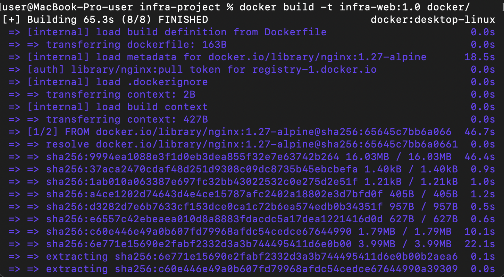  
2)Вывод git diff **после** git add \- пусто.  
3)Вывод git diff \--staged **после** git add  
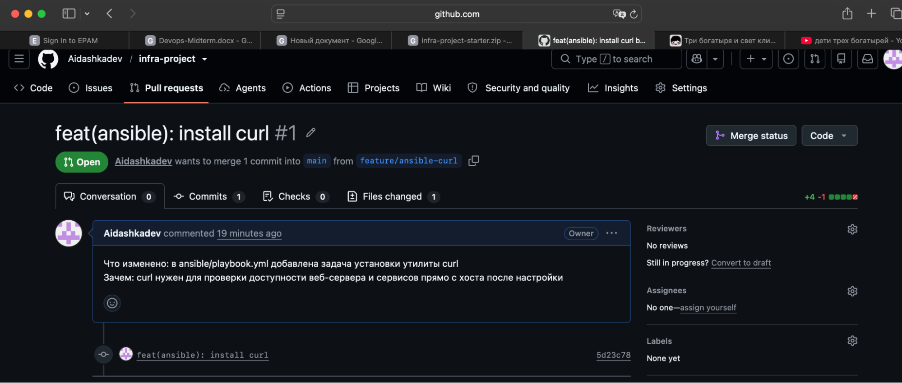  
Второй git diff ничего не показал, потому что команда git diff сравнивает рабочую директорию с индексом. После git add README.md изменение попало в индекс, и содержимое рабочей директории и индекса стало одинаковым, поэтому различий нет. Изменение, которое уже находится в индексе, показывает git diff \--staged: он сравнивает индекс с последним коммитом.

# **Блок 2\. История и ветки**

## **Задание 1.1. Настройка и первый коммит**

Вывод команды git log \- \- oneline  
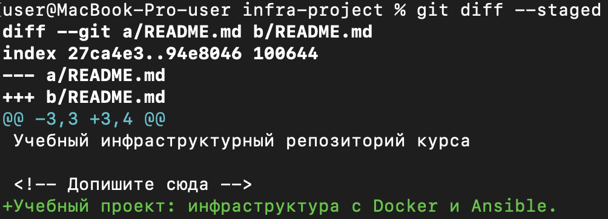  
Вывод git log \- \- oneline \- \- graph \- \- all  
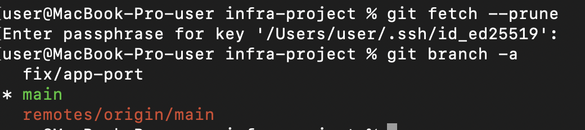  
Вывод git show HEAD-1  
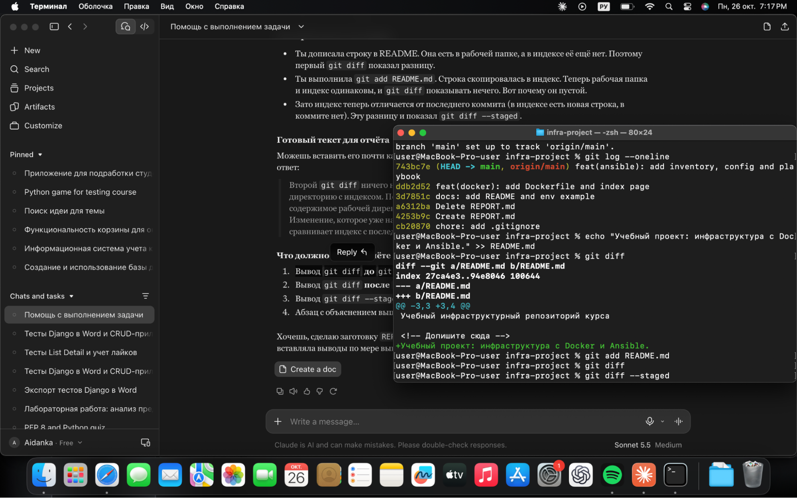  
HEAD\~1 соответствует коммиту 743bc7e2acec06f868ed62f05ccd147e79b0ac9f  
 с сообщением «feat(ansible): add inventory, config and playbook». Это родитель текущего коммита HEAD.

## 

## 

## **Задание 2.2. Ветка и слияние**

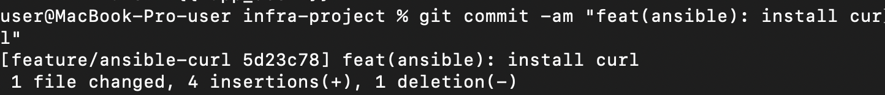  
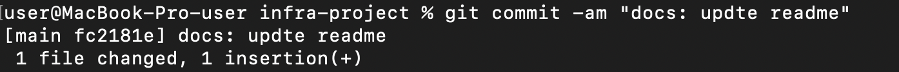  
Fast-forward возможен, когда в main после создания ветки не было новых коммитов. Тогда git не создаёт merge-коммит, а просто переносит указатель main на последний коммит ветки».

## **Задание 2.3. Конфликт слияния**

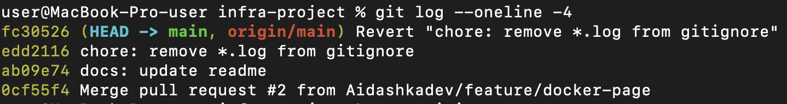  
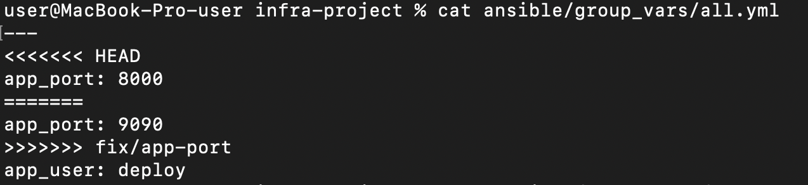  
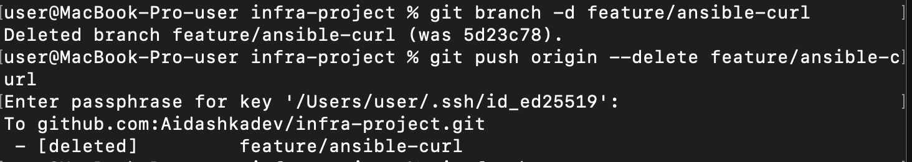  
 Конфликт возник, потому что обе ветки изменили одну и ту же строку по-разному, и git не смог выбрать автоматически. Я оставила значение 8000 и удалила маркеры

# **Блок 3\. Удалённый репозиторий и Merge Request** 

## **Задание 3.1. Получение изменений с сервера**

**Вывод git pull**  
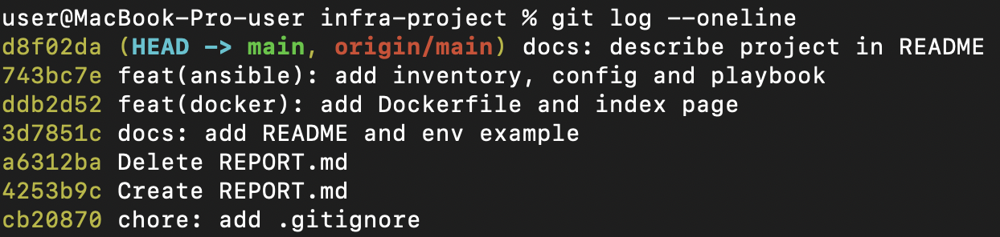  
**Вывод git log –oneline**  
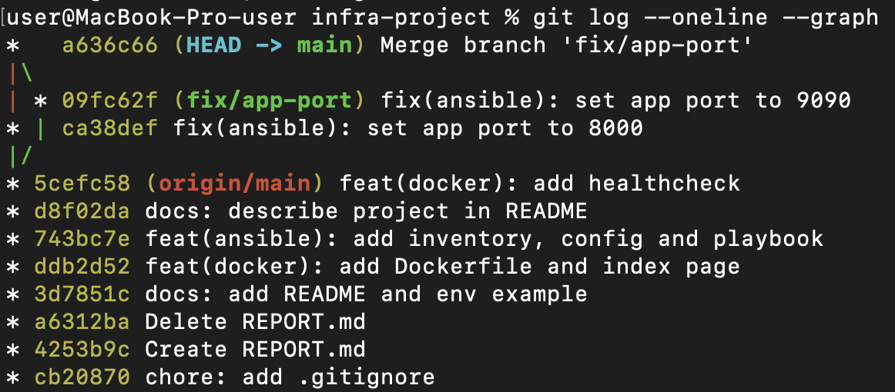  
Коммит, сделанный через веб\-интерфейс GitHub, изначально существовал только в удалённом репозитории. После **git pull** он скачался и появился в локальной истории, что видно в **git log –oneline.**

## 

## **Задание 3.2. Merge Request**

**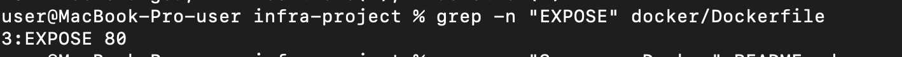**  
**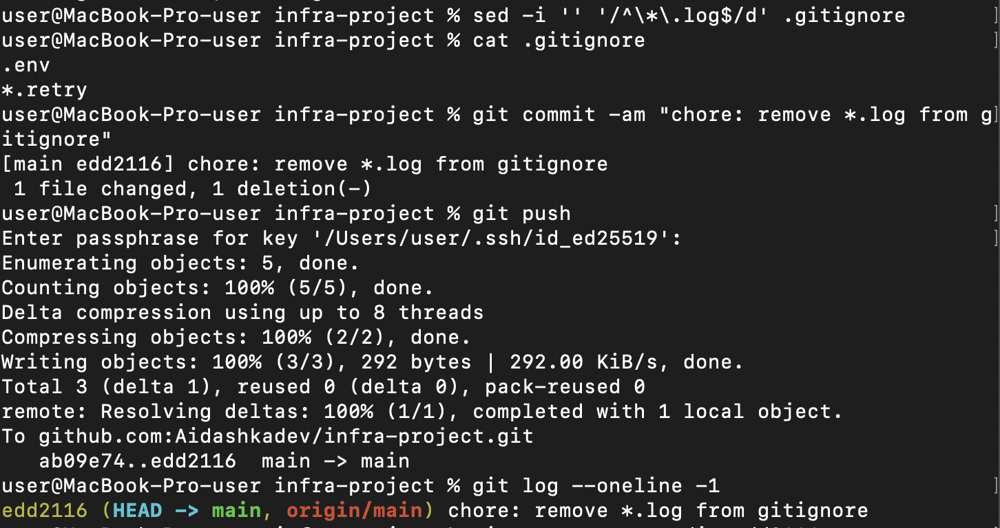**  
**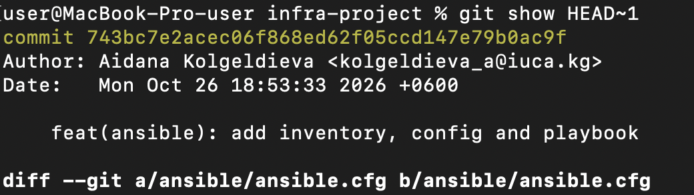**  
**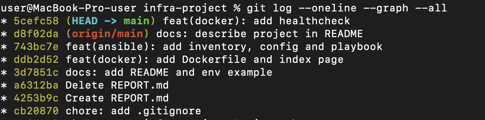**

## **Задание 3.3. Уборка веток**

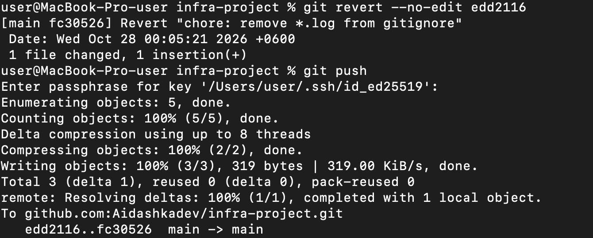  
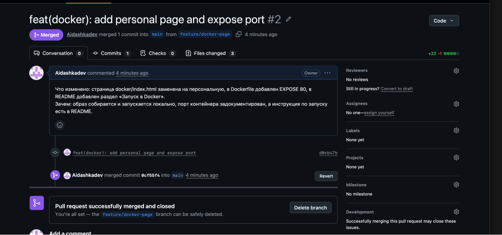  
Слитые ветки удаляют, чтобы не накапливать мусор в репозитории. git fetch \--prune убирает локальные ссылки на ветки, которых уже нет на сервере

# 

# **Блок 4\. Docker**

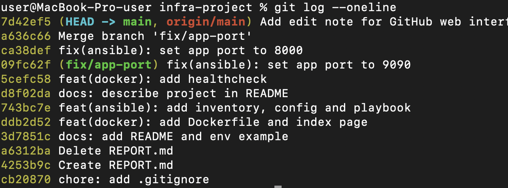  
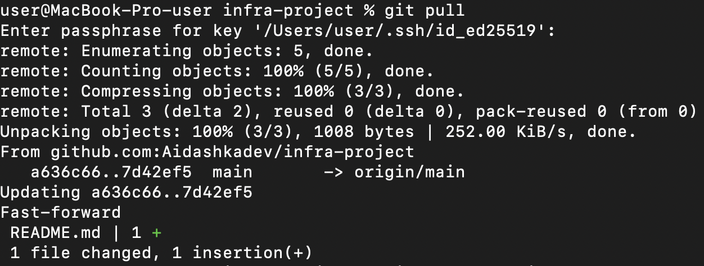  
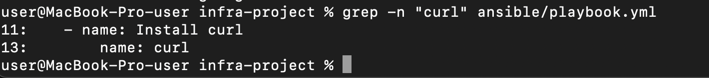  
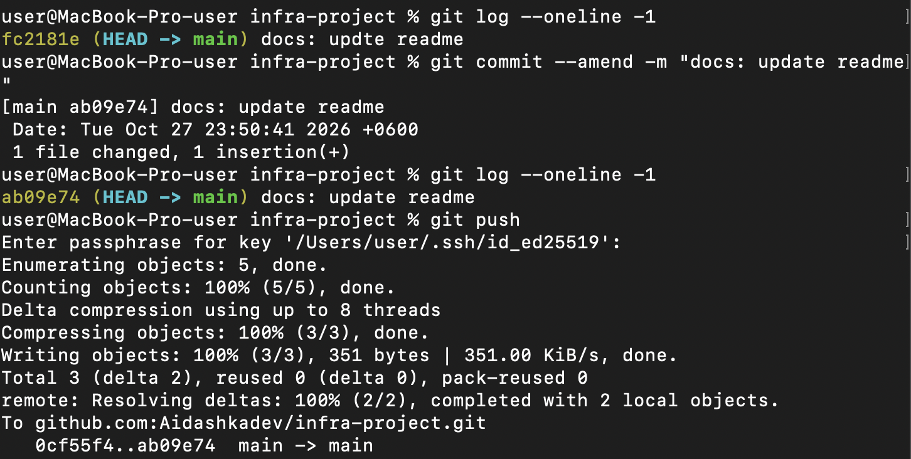

# **Блок 5\. Исправление ошибок и контрольные вопросы**

## **Задание 5.1. Отмена незакоммиченных изменений и правка коммита**

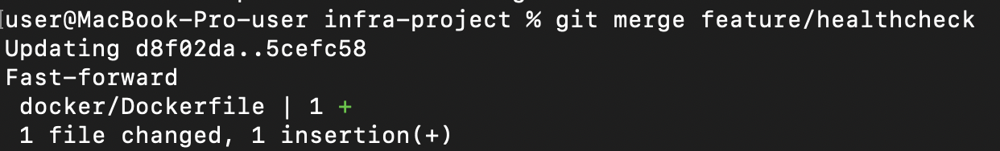  
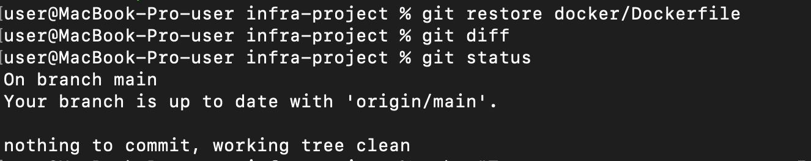  
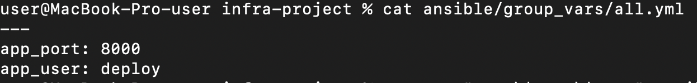  
git restore отбрасывает незакоммиченные изменения в файле. git commit \--amend заменяет последний коммит исправленным, поэтому, пока он не отправлен на сервер, опечатка нигде не остаётся в истории

## 

## **Задание 5.2. Отмена опубликованного коммита**

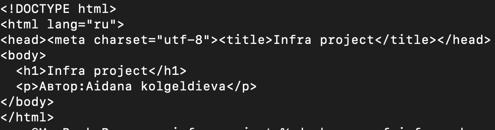  
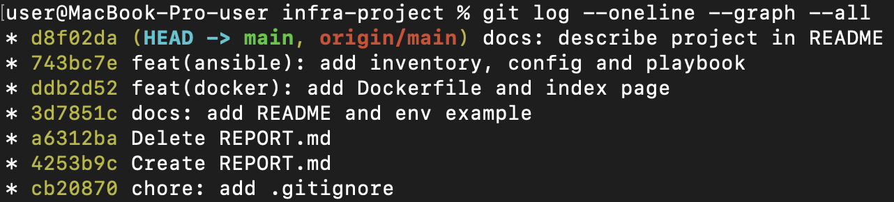  
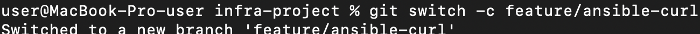  
Для уже отправленного на сервер коммита используют git revert, потому что он создает новый коммит, отменяющий изменения, и не переписывает историю. Если удалить опубликованный коммит, история на сервере разойдется с локальными копиями у других участников, и пришлось бы делать запрещённый force-push, который ещё и может затереть чужую работу

## 

## **Задание 5.3. Контрольные вопросы**

**1\. Что такое коммит и зачем нужна область индекса?**  
	Коммит это сохраненный снимок проекта в определенный момент, с автором, датой, сообщением и ссылкой на предыдущий коммит. Индекс (staging area) это «подготовительная зона» перед коммитом: командой git add я выбираю, какие именно изменения попадут в следующий коммит. Благодаря этому можно закоммитить только часть правок и делать аккуратные, логически цельные коммиты.

**2\. Что такое ветка в Git?**  
	Ветка это легкий подвижный указатель на коммит. Она позволяет вести отдельную линию разработки (новая функция, исправление), не трогая main, а потом слить результат обратно.

**3\. Что такое HEAD?**  
	HEAD это указатель на текущее место, где я нахожусь: обычно на ветку, на которой я стою, а через нее на последний коммит. От него отсчитываются записи вроде HEAD\~1 (предыдущий коммит).

**4\. Чем git fetch отличается от git pull?**  
	git fetch только скачивает новые данные с сервера и не меняет мои файлы и ветки. git pull делает fetch, а затем сразу объединяет скачанные изменения с моей текущей веткой (слияние или rebase).

**5\. Почему .env нельзя добавлять в репозиторий?**  
	В .env хранятся секреты: пароли, токены, ключи. Если файл попадет в репозиторий, он останется в истории даже после удаления, и его увидят все, у кого есть доступ (а в публичном репозитории вообще любой). Поэтому .env вносят в .gitignore, а в репозитории хранят только шаблон .env.example без настоящих значений.

